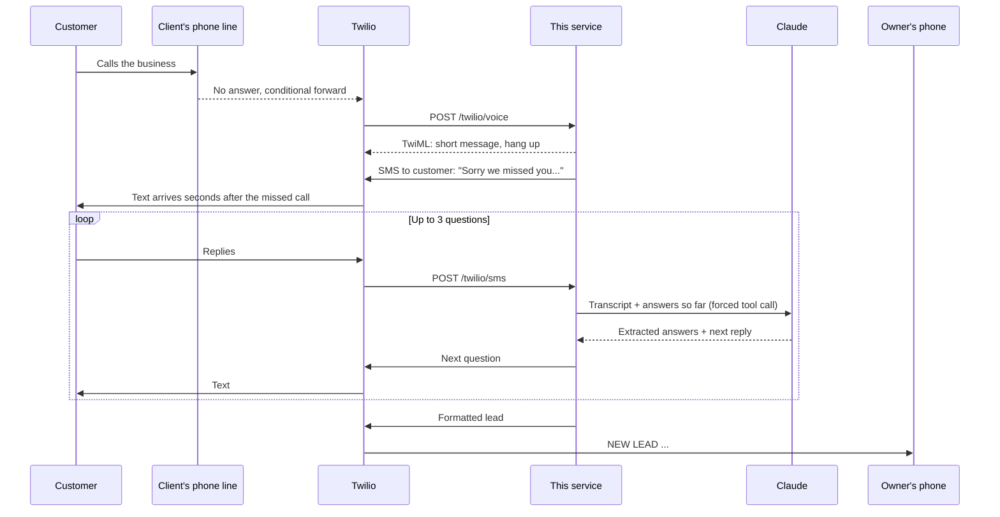

# Missed Call Capture

**A speed-to-lead system for home-service businesses.** When an HVAC, plumbing, roofing, or electrical company misses a call or gets an after-hours web form, the customer gets a text back within seconds. An AI assistant asks three qualifying questions over SMS, and the owner gets a clean, formatted lead on their phone, ready to call back and book.

I built this and sell it as a solo service to home-service businesses in Ohio. This repo is the production service plus the playbook I use to deploy it for each client.

[](https://github.com/LKoualao05/missed-call-capture/actions/workflows/ci.yml)

---

## The problem

Small trade businesses lose jobs on the phone, not on price. The owner is usually on a roof, under a sink, or driving, so calls go to voicemail. Most callers don't leave one. They call the next company on Google, and whoever picks up first usually gets the job.

Owners already know this. What they don't have is a front desk. They need something that:

- responds to every missed call immediately, day or night
- gets enough detail that the callback is a quote, not a "so what's going on?"
- works with the phone number and the phone they already have
- needs zero new apps or dashboards on their end

## What it does

```
Customer calls ──▶ no answer ──▶ instant text to customer
                                       │
                         AI asks 3 questions over SMS
                         (what's wrong, how soon, where)
                                       │
                                       ▼
                     Owner gets this on their phone:

                     NEW LEAD - Missed call 7:42 PM
                     Name: Sarah
                     Phone: (614) 555-1234
                     Need: AC blowing warm air, upstairs unit
                     When: Today if possible
                     Where: 1200 Morse Rd 43219
                     Call back: +16145551234
```

- **Two triggers:** missed calls and after-hours website form submissions.
- **AI qualification:** Claude runs the SMS conversation, so it handles real replies (one text that answers two questions, a name dropped mid-sentence, a "yes" that means "it's an emergency"). The questions are configurable per trade.
- **Emergency escalation:** gas smell, carbon monoxide, flooding, or no heat in winter alerts the owner immediately instead of waiting for all three answers, and tells the customer to get safe.
- **Partial leads:** if the customer stops replying, the owner still gets what was collected after 20 minutes.
- **Service-area check:** leads with a ZIP outside the client's area are flagged.
- **Compliance built in:** STOP/HELP handling, opt-out tracking, Twilio signature validation, A2P 10DLC registration in the onboarding steps.

## How it works



A few choices worth calling out (full reasoning in [docs/decisions.md](docs/decisions.md)):

- **The model proposes, the code decides.** Claude returns structured answers through a forced tool call. Code merges them, drops anything that isn't a configured question, and decides when the lead is complete. The closing message and lead format are deterministic.
- **The caller is never stranded.** If the Claude call fails, times out, or returns something malformed, a scripted qualifier handles that turn. The conversation keeps moving.
- **Webhooks return immediately.** SMS replies run as background tasks, so Twilio never waits on the LLM.
- **Clients keep their number.** The default mode uses their carrier's "forward when busy or no answer" setting. A second mode makes the Twilio number the front line and rings the owner first.
- **New client = config, not code.** Each business is one YAML entry: number, hours, timezone, questions, service area.

## Deploying it for a client

The code is half of this. The other half is fitting it into how a specific business already runs. For each client I follow a fixed playbook:

| Stage | What happens | Doc |
| --- | --- | --- |
| Discovery | 20-minute call: call volume, who answers, after-hours process, what they ask on a callback, service area, emergency policy | [discovery-checklist.md](docs/discovery-checklist.md) |
| Configure | Tailor the three questions to their trade and how they quote. Hours, ZIPs, voice message | [client-onboarding.md](docs/client-onboarding.md) |
| Provision | Local Twilio number, A2P 10DLC registration, webhooks, carrier forwarding, website form hookup | [client-onboarding.md](docs/client-onboarding.md) |
| Acceptance test | Owner calls from a personal phone, plays the customer, and approves the lead text before go-live | [client-onboarding.md](docs/client-onboarding.md#5-acceptance-test-with-the-owner) |
| Run | Stale-lead cron, monitoring, monthly metrics check-in | [runbook.md](docs/runbook.md) |

## Repo map

```
app/
  main.py          HTTP layer: Twilio voice/SMS webhooks, web form, admin endpoints
  service.py       Core flow: text-back, reply handling, lead delivery, stale flush
  qualifier.py     Claude qualifier (tool use) + scripted fallback + guardrails
  leads.py         Owner-facing lead format, service-area check
  clients.py       Per-client config, business hours, registry
  compliance.py    STOP / START / HELP keywords
  store.py         SQLite persistence
  telephony.py     Twilio client, TwiML, signature validation, fake messenger
config/
  clients.example.yaml
docs/              Architecture, onboarding playbook, discovery, runbook, decisions
scripts/
  simulate.py      Play the customer in your terminal, no Twilio needed
tests/             35 tests, no network
```

## Run it locally

```bash
git clone https://github.com/LKoualao05/missed-call-capture.git
cd missed-call-capture
python -m venv .venv && source .venv/bin/activate
pip install -e ".[dev]"

pytest -q                                   # full suite, no network or keys needed
python scripts/simulate.py                  # be the customer in your terminal
ANTHROPIC_API_KEY=sk-... python scripts/simulate.py --claude
```

The simulator is also how I demo it on a sales call. The owner types as a customer and sees the exact text that would land on their phone.

To run the server against real Twilio:

```bash
cp .env.example .env                        # Twilio + Anthropic keys, public URL
cp config/clients.example.yaml config/clients.yaml
make run                                    # or: docker build -t mcc . && docker run -p 8000:8000 --env-file .env mcc
```

Then point the Twilio number's voice and messaging webhooks at `https://<your-host>/twilio/voice` and `https://<your-host>/twilio/sms`.

## Endpoints

| Method | Path | Called by | Purpose |
| --- | --- | --- | --- |
| POST | `/twilio/voice` | Twilio | Incoming or forwarded call |
| POST | `/twilio/dial-status` | Twilio | Result of ringing the owner (front-number mode) |
| POST | `/twilio/sms` | Twilio | Customer reply |
| POST | `/forms/{client_id}?key=...` | Client website | After-hours form (JSON or form-encoded) |
| POST | `/tasks/flush-stale` | Cron | Send partial leads for quiet conversations |
| GET | `/admin/clients/{id}/metrics` | Me | Time to first text, reply rate, qualified rate |
| GET | `/healthz` | Uptime monitor | Liveness |

## Stack

Python 3.11+, FastAPI, Twilio Programmable Voice and Messaging, Anthropic Claude API (tool use), SQLite, Docker, GitHub Actions.

## Roadmap

- Google Calendar slot offers in the closing text for clients who want booking, not just a callback
- Spanish-language conversations, detected from the first reply
- Per-client weekly summary text to the owner
- Postgres option once a single region passes a few dozen clients

---

Built by [Lemuel Koualao](https://github.com/LKoualao05). MIT licensed.
