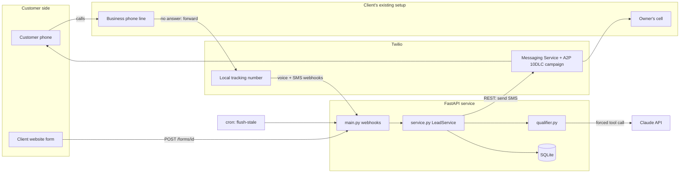
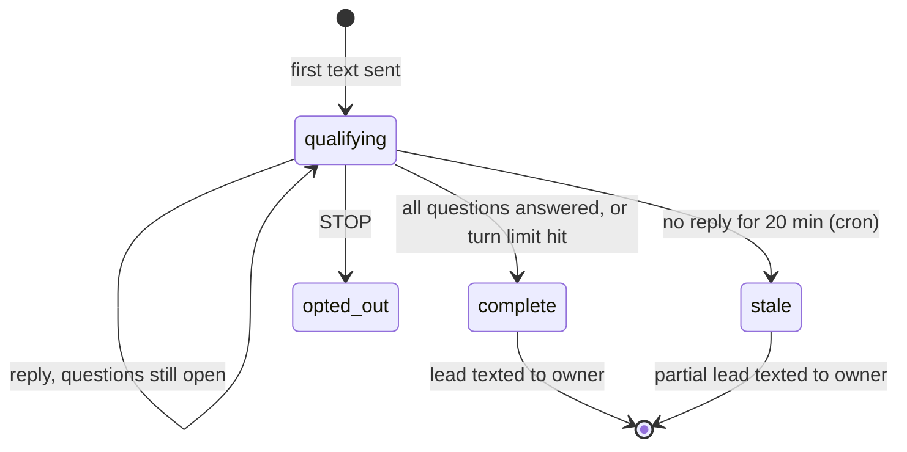

# Architecture

## Components



One deployment serves every client. Twilio tells us which client a webhook belongs to through the `To` number, which maps to exactly one entry in `clients.yaml`.

## Call modes

| Mode | Client setup | What reaches us | When to use |
| --- | --- | --- | --- |
| `conditional_forward` (default) | Carrier forwards busy and unanswered calls to the Twilio number | Only missed calls | Client wants to keep their number and their phone ringing exactly as it does today |
| `front_number` | Twilio number is the published number | Every call. We `<Dial>` the owner for `ring_timeout_seconds` | New business, or one that already uses a tracking number on Google and their site |

In both modes, a call outside business hours goes straight to text-back and is labeled after-hours on the lead.

## Conversation lifecycle



Emergencies don't change state. They trigger an extra owner alert the first time danger is mentioned, and the conversation keeps collecting details.

## Data model

`conversations`: one row per text-back.

| Column | Notes |
| --- | --- |
| `client_id`, `caller` | Caller in E.164 |
| `source` | `missed_call`, `after_hours_call`, `web_form` |
| `status` | `qualifying`, `complete`, `stale`, `opted_out` |
| `answers` | JSON keyed by question key |
| `transcript` | JSON list of `{role, text, at}` |
| `caller_name`, `emergency` | Pulled out of the conversation |
| `created_at`, `first_text_at`, `first_reply_at`, `lead_sent_at` | Used for speed and conversion metrics |

`opt_outs`: `(client_id, phone)`. Checked before every text-back.

## The qualifier contract

`ClaudeQualifier.next_turn` sends Claude a system prompt (business, trade, the configured questions, and the rules), plus the answers so far, the transcript, and the newest text. `tool_choice` forces a `record_turn` call whose schema is generated from that client's questions:

```json
{
  "answers": {"need": "...", "urgency": "...", "location": "..."},
  "caller_name": "Sarah",
  "emergency": false,
  "reply": "Thanks Sarah. How soon do you need someone out?"
}
```

`finalize()` then applies the rules the model is not trusted with:

1. Merge new answers into existing ones. Never erase an answer with a blank.
2. Drop keys that aren't configured questions.
3. Completion means every question has an answer, as checked by code.
4. Emergency is sticky, and keyword matching can set it even if the model doesn't.
5. When complete, replace the model's reply with the fixed closing message.
6. Cap the reply at 320 characters (two SMS segments).

## Failure modes

| Failure | Effect | Handling |
| --- | --- | --- |
| Claude API down, slow, or rate limited | Turn would hang | Exception caught, `ScriptedQualifier` answers that turn |
| Claude returns malformed or empty output | Bad text to customer | Validated, falls back to script |
| Customer stops replying | Lead never completes | Cron sends partial lead after `STALE_AFTER_MINUTES` |
| Customer calls three times in a row | Three text threads | Dedupe window (30 min) |
| Endless back-and-forth | AI keeps talking | `MAX_CALLER_TURNS` closes it and hands off to the owner |
| Forged webhook | Spam texts on client's number | Twilio signature validation, form `key` |
| Customer texts STOP | Legal exposure if we keep texting | Opt-out stored, conversation closed, future text-backs skipped |
| Service restarts mid-conversation | Lost state | State is in SQLite, not memory |
